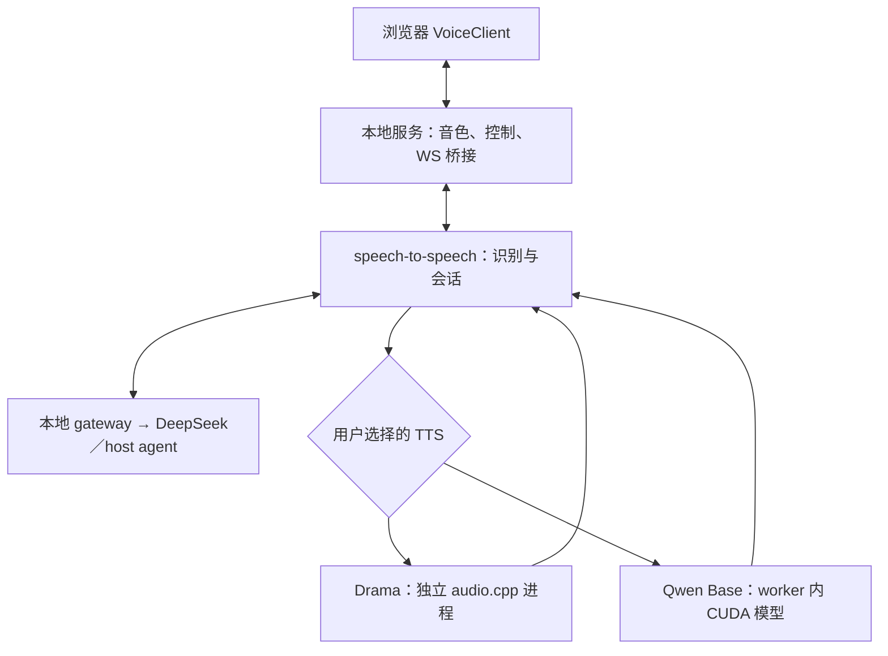

# 0.4 架构与状态契约

0.4 已实现两个可选择的本地语音后端：**Drama 3 主用，Qwen3-TTS 0.6B Base 备用**。两者复用相同的参考音色库、中文／英文识别、DeepSeek 或 host agent 文字接口、实时字幕和打断界面。用户明确选择后端，程序不会在失败时偷偷切换模型或示范模式。

JOSIE 是公开交互设计的参考；本项目独立编写控制器和界面，没有使用其未公开的 SwiftUI／MLX 应用源码。可复用接口见 [REUSE.md](REUSE.md)，固定依赖和兼容修改见 [PATCHES.md](PATCHES.md)。

## 1. 进程和数据流

| 层 | 职责 | 默认接口 |
| --- | --- | --- |
| Edge／Chrome | AudioWorklet 收音、Web Audio 播放、字幕、状态、音量驱动的动态界面 | `http://127.0.0.1:8790` |
| `her_voice`／aiohttp | 同源静态资源、控制 token、参考音色管理、WS 桥接、单 live session、进程控制 | `/api/*`、`/ws/realtime` |
| 本地文字 gateway | 持有云端 key，验证／转发 Chat Completions 和 SSE | `/llm/v1/chat/completions` |
| speech-to-speech worker | Silero／Smart Turn、faster-whisper、多轮文字、所选 TTS handler、Realtime 协议 | `ws://127.0.0.1:8791/v1/realtime` |
| audio.cpp 原生进程，仅 Drama 模式 | 加载固定 GGUF、专家卸载、参考音色合成、HTTP PCM 音频流 | `http://127.0.0.1:8792/v1/audio/speech` |
| DeepSeek 或 host adapter | 接收文本和上下文，返回可朗读的流式回复 | 所选 Chat Completions endpoint |



原始麦克风数据只沿本机浏览器与本地语音引擎传输；识别后的文字和保留的上下文会发给所选文字 provider。speech worker 只收到随机的本地 gateway token，不收到 DeepSeek／generic provider 的 key；native Drama 也不需要这些 key。浏览器拿到的是本地控制 token。

实时麦克风音频不保存成录音文件，字幕保留在页面内存中。**用户主动导入的参考 WAV 和对应文字会保存到 workspace 的 `voices/`**，用于重新启动后复用音色。上游可能向终端输出对话，supervisor 的内存日志环最多保留最近 80 行；公开 health 不返回 `log_tail`，详见 [UPSTREAM.md](UPSTREAM.md)。

## 2. VoiceStore：两个后端共用的参考音色

[`VoiceStore`](../her_voice/voices.py) 负责导入、验证、列出、选择音色，不导入推理包，也不下载模型。

| 项目 | 当前实现 |
| --- | --- |
| 输入 | 16 位 PCM WAV，单声道或双声道，8,000–96,000 Hz，1–30 秒，最多 12 MiB |
| 建议素材 | 干净的 5–15 秒人声，附与实际录音一致的完整文字 |
| 标准化 | 检查帧长度，拒绝全零静音，双声道平均为单声道，重新写出 PCM16 WAV；保留原采样率 |
| 标识 | 服务器生成随机 32 位十六进制 `voice_id`；不用上传文件名构造路径 |
| 名称和文字 | 名称最多 80 字符，参考文字最多 2,000 字符 |
| 保存内容 | `voices/<id>.wav`、`voices/<id>.json`；后者包含名称、文字、采样率、时长和创建时间 |
| 已选设置 | `.runtime/voice-selection.json` 中的 `backend` 和 `voice_id` |

导入仅保存素材，随后要显式应用音色设置。两套后端都需要选择参考音色；相同音色 ID 可以分别用于 Drama 和 Qwen。参考录音条件化不是训练：不会更新模型权重，也不保证两个模型合成出完全相同的音色。

对外接口返回音色元数据，不返回本地绝对路径。参考文件不会通过静态资源路由发布。素材的实际可用性、口音、跨语言音色一致性仍需要目标模型试音确认。

## 3. VoiceEngine：单 GPU 的启动和切换

[`VoiceEngine`](../her_voice/tts.py) 是当前控制器，内部组合既有 `EngineSupervisor` 和新增 [`DramaSupervisor`](../her_voice/drama.py)。读取基础 profile 后，生成 `.runtime/selected-voice-pipeline.yaml`，只替换 TTS block，保留同一识别、文字生成和 Realtime 连接方式。

Drama 启动顺序：

1. 验证已选音色和固定 native 安装凭据，生成独立 `session-server.json`。
2. 启动本应用拥有的 audio.cpp 进程，检查 `/health` 和 `/v1/models`。
3. 确认 `drama-3`、`fish_drama3`、`tts`、`streaming` 的注册信息后，启动 speech worker。
4. speech worker 验证上游补丁、准备固定识别模型，启用 Drama 重采样 hook，然后进入上游启动／暖机。
5. 上游服务完成准备后，浏览器建立 live session。

native 的 ready 只证明 HTTP 服务和模型注册可用。其配置使用 `lazy_load=true`，因此不能把它等同于模型已经完成 GPU 推理。对外 `VoiceEngine.ready` 还需要 speech worker 就绪。

Qwen 启动时使用 `Qwen/Qwen3-TTS-12Hz-0.6B-Base`，把参考 WAV 和文字传入 `qwen3_tts_ref_audio`／`qwen3_tts_ref_text`，`speaker=null`、`xvec_only=false`、`language=auto`。它在 speech worker 内加载，不启动 audio.cpp。固定模型下载信息见 [依赖说明](DEPENDENCIES.md) 和 [`her_voice/models.py`](../her_voice/models.py)。

[固定 Qwen handler](https://github.com/huggingface/speech-to-speech/blob/0ed1bb95bd335aa89bb7c172b6a347b6dae596f8/src/speech_to_speech/TTS/qwen3_tts_handler.py) 调用 `generate_voice_clone_streaming()`，传入 `streaming_chunk_size=8`。其中 `non_streaming_mode=true` 是文本预填充模式参数，不表示等完整音频生成完才输出；代码仍消费生成器的音频块。实际首包时间、分块连续性和取消时的 GPU 响应仍需真机测量。

应用新后端或音色时，客户端先停止收音／播放并关闭 session；服务器关闭本应用剩余的会话，**先停止 speech worker，再停止 native Drama**，然后保存新选择。用户再次点击开始才加载新配置。两套 TTS 不同时常驻 GPU，也不会在通话中热换成另一套权重；普通暂停或结束 session 可以保留当前暖机进程。

控制器使用启动代次和取消状态管理后台准备工作；停止后，旧启动任务不能重新拉起服务。启动失败的清理必须限制在自己的代次。supervisor 只管理自己创建的进程，端口已被其他服务占用时拒绝接管。这样的生命周期控制不代替真实显存验收：ASR 和所选 TTS 仍会共享 16 GB GPU。

## 4. Drama 的实际传输与卸载配置

native runtime 固定为 [0xShug0/audio.cpp `0bf4d155f2af5f85853415170622dc145e3d62c3`](https://github.com/0xShug0/audio.cpp/commit/0bf4d155f2af5f85853415170622dc145e3d62c3)。安装器固定模型 revision、完整文件大小及 SHA-256；运行时使用安装凭据和文件状态检查，不在每次开始对话时重读约 23 GiB 的 GGUF。

实际仓库来源以 [`scripts/prepare-drama.py`](../scripts/prepare-drama.py) 中的固定定义为准。模型使用 Q4 专家与 Q8 backbone 的 GGUF 组合，并启用 `disk_experts=true`、`pin_experts=true`、`expert_cache_size=8`、`cpu_expert_layers=0`、`context_length=2048`。这是[原生 Drama 模型文档](https://github.com/0xShug0/audio.cpp/blob/0bf4d155f2af5f85853415170622dc145e3d62c3/docs/models/fish_drama3.md) 所述的主机内存保留专家、GPU 缓存／计算专家路径；`cpu_expert_layers=0` 不能被解释成所有专家权重常驻显存。实际占用、加载时长和速度要在 Windows 4080 SUPER／64 GB 上验收。

当前复用固定 upstream 的 `OpenAICompatibleTTSHandler`，请求的是本地 TTS endpoint。关键配置由 `build_profile_settings()` 生成：

```yaml
backend: openai
settings:
  openai_tts_base_url: http://127.0.0.1:8792/v1
  openai_tts_api_key: ""
  openai_tts_model: drama-3
  openai_tts_voice: <已导入的 voice_id>
  openai_tts_language: null
  openai_tts_response_format: pcm
  openai_tts_sample_rate: 44100
  openai_tts_stream: false
  openai_tts_blocksize: 512
```

`openai_tts_stream:false` 关闭的是上游特定的 vLLM 请求扩展。PCM 路径仍会在请求中设置 **`stream_format:"audio"`**，使用 HTTP 流逐块读取音频，不是等待整段响应缓存完成。固定 native 源码从合成音频事件直接写出 HTTP chunks；原始 PCM16 单声道采样率为 **44.1 kHz**。参考音色通过 native `voice_presets` 配置绑定到请求的 `voice`，不依赖上游配置 schema 中不存在的 `gen_kwargs` 字段。

原生配置没有通用 API key 鉴权接口，本项目将其绑定到 loopback、禁用管理 UI、拒绝占用端口。它没有经过本地 gateway 转发，也不接触 DeepSeek key；应用自己的 token 仍保护浏览器控制操作。

## 5. 音频采样率与流式边界

| 边界 | 格式和处理 |
| --- | --- |
| 实际麦克风 → AudioWorklet | 通常由设备提供 44.1／48 kHz float 音频，请求 mono、AEC、降噪、自动增益 |
| 浏览器 → Realtime wire | 24 kHz PCM16LE，40 ms 一包 |
| 上游识别内部 | VAD 等内部使用 16 kHz，不与 wire 采样率混用 |
| Drama HTTP → TTS handler | 44.1 kHz PCM16LE，允许任意 HTTP 分块，包含跨样本的字节边界 |
| Drama handler → 上游内部 | 每个响应独立 SoXR 连续重采样到 16 kHz，512 样本一块，流末 flush，再补齐最后一个固定块 |
| 上游 → 浏览器播放 wire | 会话约定 24 kHz PCM16LE，由上游转换；浏览器按此速率播放 |

Qwen 使用自己的固定 handler 处理模型输出，不套用 Drama 的 44.1 kHz 参数。客户端 session 明确保留 `transcription.language:null`，并省略 `audio.output.voice`，让服务端已选参考音色生效；重连不应再发送内置 speaker 覆盖它。

Drama hook 保留 HTTP、字节解码和取消实现，仅用 `soxr.ResampleStream` 替换该 worker 内的重采样类。连续状态跨音频块保留，流末会 flush；取消后的新响应使用新状态，旧滤波尾部不会进入新回复。完整 SHA 校验、CRLF 规则与测试依据见 [PATCHES.md](PATCHES.md)。

浏览器输入侧的 weighted integration 重采样器也跨块保留状态，但不是同一个 SoXR 模块。它避免输入块之间的长度漂移；更高质量的麦克风带限滤波仍可单独迭代。

播放使用 Web Audio 连续排程，起始约 35 ms 缓冲，最多排队 20 秒；超过上限会中止本轮，避免积压过期内容。`response.done` 表示生成完成，音频节点全部播放结束才表示听觉输出完成。界面显示的“事件至播放约”从语句结束事件／文字提交计到首段预计播放时刻，不等于经过设备延迟校正的端到端测量。

## 6. 打断、暂停、结束的边界

| 操作 | 浏览器行为 | 会话／推理行为 |
| --- | --- | --- |
| 自然插话 | 停止当前和排定音频，隔离旧 `response_id`，继续收音 | 带 ID 的 cancel 经 bridge 检查后转给上游，在原 session 中处理新话语 |
| 手动打断、暂停、切换文字输入 | 清播放、停旧收音发送、提升 client epoch、关闭旧 WS | 等旧会话释放，再开 session；恢复最多 30 条已完成且非空的文字 |
| 结束对话 | 关闭音频设备和 session，保留页面内已完成字幕 | 当前模型可以保持暖机；再次开始可恢复文字 |
| 清除并重设 | 断线并清空当前客户端字幕／可恢复上下文 | 不删除已导入音色，也不删除 host 的记忆或任务 |
| 应用后端／音色、停止引擎 | 关闭会话，清播放 | 顺序停止本应用拥有的 speech 和 native 进程，释放其资源 |

**已测试的是本地播放队列清理、晚到音频隔离、HTTP 首音前／流中取消，以及受控进程停止。** 这些结果不能推导出 GPU 计算在所有阶段都能立即取消。固定 audio.cpp 会在后续音频事件／HTTP 写出发现连接已经断开；如果尚处于首音前的长 prefill，原生计算可能继续到下一次可检查边界。显式停止引擎会终止本应用拥有的原生进程，但这不同于每轮插话都立即中止 GPU kernel。

固定上游忽略 `response.cancel` 中的 response ID，所以 bridge 的匹配检查不能省略。`conversation.item.truncate` 在此版本是 no-op，自然插话也没有精确的“仅保留用户实际听见的文字”截断。完成字幕与已听到内容不能当成同一份持久记忆。

暂停／手动打断重建 session，是为了隔离旧 ASR 和迟到事件。`draining` 最多等待 45 秒，`stuck` 会提示重启引擎；不能把浏览器立即静音的耗时当成模型池重新空闲的耗时。

## 7. 状态、双语和文字 provider

| 语音状态 | 依据 |
| --- | --- |
| `idle` | 尚未开始或已结束 |
| `listening` | 已连接，当前没有生成／播放任务 |
| `thinking` | 语句结束后等待生成，或音频短暂欠料 |
| `speaking` | 当前存在正在／等待播放的音频 |
| `paused` | 旧播放和收音已停止，保留可恢复的文字 |
| `interrupted` | 旧输出被隔离，等待下一轮 |

`connection`、引擎启动状态与上述语音状态分别表示不同事情。参考音色读取／导入／应用还有独立 `voiceAdmin` 状态；失败不会自动转为 demo。

ASR 使用多语言 Whisper small，语言自动检测；关闭上游单语输出分类，Qwen 保留 `language:auto`，Drama 不发送固定单语覆盖。默认 prompt 优先遵从明确语言要求；否则中文问题用简体中文回答，英文问题用英文回答，混合文字保留术语。提示词和接口支持已落地，混说发音、口音及指令遵循仍需实测，见 [BILINGUAL.md](BILINGUAL.md)。

DeepSeek 路径使用 Chat Completions 和流式文字，gateway 注入 `thinking={"type":"disabled"}`，过滤上游 Qwen 专用参数；generic provider 不注入此字段。SSE 只转发完整事件，保留 UTF-8，未收到完整 `[DONE]` 就断流会作为错误；401／402／429 不回显 provider 原始敏感内容，也不跟随 POST redirect。浏览器取消会结束对应 provider 连接。

云端 gateway 直连，不自动读取 proxy／netrc；模型下载遵守其下载库配置。speech worker 的 `NO_PROXY`／`no_proxy` 保留已有条目并加入 `127.0.0.1,localhost`，防止本地 gateway 和 Drama 请求进入外部代理。即使换成 host agent，本模块也不自行执行工具或建立长期记忆；host 的工作身份与取消协议见 [REUSE.md](REUSE.md)。

## 8. 验证入口

- [`test_voices.py`](../tests/test_voices.py)、[`test_tts_selection.py`](../tests/test_tts_selection.py)：参考音色、选择、生成 profile 和单后端生命周期。
- [`test_drama_runtime.py`](../tests/test_drama_runtime.py)：安装凭据、原生配置、就绪、拥有进程的清理、拒绝外部占用端口。
- [`test_drama_stream.py`](../tests/test_drama_stream.py)：校验固定 upstream 源码后执行原 HTTP／解码方法，用真实 loopback HTTP fixtures 验证首块早于响应结束、44.1→16 kHz、字节分块、取消、尾部 flush 和 CRLF。
- [`audio.test.mjs`](../tests/audio.test.mjs)、[`client.test.mjs`](../tests/client.test.mjs)、[`voice-settings.test.mjs`](../tests/voice-settings.test.mjs)：播放清理、旧事件隔离和显式音色切换。
- [CPU 重采样微测记录](evidence/drama-resampler-benchmark.json)：局部 CPU 处理开销，不能作为整体延迟或 Windows GPU 性能。
- [Windows 实机验收](WINDOWS_ACCEPTANCE.md)：真实编译、GPU／内存、模型质量、麦克风、扬声器、AEC、DeepSeek 和端到端时间仍需目标电脑验证。
