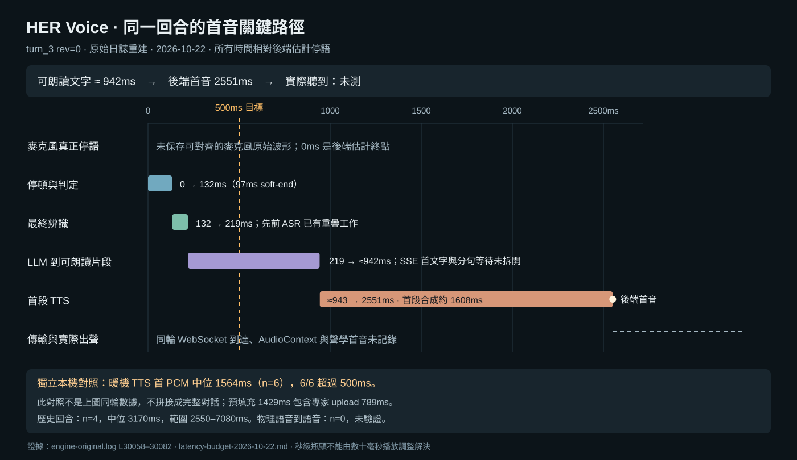

# HER Voice：500ms 語音到語音延遲驗證

日期：2026-10-22。基線：main / `88505c9ae6a00b9d1e9b34e1ae02870753d7ca97` 加上本輪開始時既有未提交修改。保留 Drama 3、DeepSeek、完整 Samantha 參考、Prompt 與 Nuroum 選擇。本輪無付費請求、無服務重啟、無模型下載或複製。

## 結論

**現有執行路徑沒有穩定接近 500ms 的證據，已觀測的路徑明顯超出目標。** 最新可重建的既有會話中，4 個完成回合的後端延遲為 2.55–7.08 秒，中位數 3.17 秒；這仍未包含可驗證的實際揚聲器輸出。這次固定中文輸入的暖機本機 TTS 基線，首個 PCM 中位數 1.564 秒，6/6 超過 500ms。

本次沒有取得「原始麥克風波形終點 → 同一錄音中的實際回答首音」樣本：**該嚴格指標 n=0，不能報出其 P95，也不能宣稱已驗收。** 舊會話在最後一次短語言探測修正之前；其數值不是目前完整版本的新對話結果。下述本機對照使用目前執行中的 native 服務。這些證據足以否定「目前已穩定達標」的說法，但不是證明固定模型永遠不可能做到 500ms。

唯一實作候選是減少每次本機 HTTP client 建立開銷。中位數首 PCM 減少約 72ms，但尾端與連續性未證明改善，**不保留候選**。它只在隔離量測程序中生效；原 worker、上游檔案、native 二進位及正式設定均未被它修改，程序退出即回退。

## 同一輪的時間線與證據邊界

來源：私有 `work/latency-budget-20261022/engine-original.log`；session `session_612cad40bf13433a8610c938d0fa40c5`，`turn_3 rev=0`，response key `56eec4a5645143b19d5a213f589afa8b`。這是短英語辨識結果，不代表中文、多輪長句或噪音下的分布。

所有下列時間均換算到該回合的**後端估計語音終點**。終點由首音日誌 05:27:57.127 減去其高精度 e2e 2.551s，推得原始日誌時鐘 05:27:54.576；原始日誌時區未另作推定。毫秒日誌及三位小數 duration 有約毫秒級捨入，且程序排程／日誌延遲並非零。

| 事件 | 相對時間 | 原始證據／可信範圍 |
| --- | ---: | --- |
| 真正麥克風語音終點 | 未測 | 未保存可對齊的原始麥克風 PCM；不以後端估計冒充 |
| 後端估計語音終點 | 0ms | 由該回合 e2e 回推；VAD 使用 sample-to-clock anchor |
| Speech soft-ended | 97ms | 第 30058 行 |
| Smart Turn 判定完成；開始最終辨識 | 132ms | 第 30059–30060 行；判定耗時 34.7ms |
| 最終辨識完成 | 219ms | 第 30063 行 |
| DeepSeek 代理 HTTP 200 | 332ms | 第 30064 行；這是 response headers，**不是首個文字 delta** |
| 首個可供 TTS 的 LLM 輸出 | 約 942ms | 第 30065 行的 handler yield，結合隨後 TTS 起點判定；沒有原始 SSE 序列可拆出分句等待 |
| TTS handler 起點 | 約 943ms | 第 30081 行 1.608s 回推；約 1ms 交接差不能當成精確排隊量測 |
| native TTS HTTP headers | 980ms | 第 30070 行；尚無 PCM |
| 後端首段可輸出音訊 | 2551ms | 第 30081–30082 行；TTFA 與 e2e 含義以原始程式確認 |
| WebSocket 抵達瀏覽器 | 未測 | 該回合沒有保存 Performance trace |
| 裝置輸出／使用者實際聽到首音 | 未測 | 無同輪 loopback 或聲學錄音 |

VAD 最終辨識前已有 speculative ASR 工作，因此不能把完整 ASR 計算時間再次加上去。首段 TTS 與後續 LLM／後續音訊生成也可重疊；完整 LLM 時間、完整 TTS 時間不能直接相加成首音延遲。

這一輪已觀測的關鍵路徑是：**估計停語 → 停頓判定／最終辨識 → 可朗讀文字 → 首段合成 → 後端輸出**。首個可朗讀片段在 942ms 才出現，當時尚未開始首段 TTS；後續約 1608ms 才有音訊。兩個具體阻擋點都已超過整體 500ms 預算。

## 計時方法

- 歷史日誌只對齊同一 session、turn、revision 與 response key。Python 內部 duration 使用 `perf_counter`；舊日誌沒有完整絕對單調時間戳，無法事後重建跨程序零誤差同步。
- 新的 13 次本機請求以 `perf_counter_ns` 記錄起點、headers、每一 PCM chunk、終點，另外保存 `time.time_ns` 作粗略牆鐘參照。native 計數器以順序及日誌新增區段對應請求；量測前確認 pool idle，native／speech PID 不變。
- 瀏覽器以 `performance.now()`／Performance marks 記錄離線重播的到達、排程回呼和取消；保存 `AudioContext.getOutputTimestamp()`。它和 Python 資料共用的是**重播的相對起點**，不是同一個真實對話的跨程序時鐘。
- 目前 `web/protocol.js` 的回合起點是收到 speech-stopped 事件；`web/audio.js` 的 `onStart(..., true)` 是依 AudioContext 排程的 timer callback。兩者均不足以等同物理聲音首尾。瀏覽器回報 `outputLatency=0` 也不能證明裝置零延遲。
- 現有 native 計數器已能定位預填充／傳輸等待，故本輪未安裝或啟用 WPR／WPA、Nsight Systems。尚未把 CPU 計時的 upload 值聲稱為純 GPU DMA／PCIe 時間。

## 實測分布與首次／暖機區分

單位 ms。採樣分位數使用 nearest-rank；n=4 或 n=6 的 P95 等於最大值，**不是可靠母體 P95 或穩定性保證**。

| 樣本及量測範圍 | n | 最小 | 中位數 | 樣本 P95／最大 | ≤500ms |
| --- | ---: | ---: | ---: | ---: | ---: |
| 舊會話後續完成回合，估計停語→後端首音 | 4 | 2550 | 3170 | 7080 | 0/4 |
| 本次空閒後首個本機 TTS 請求 | 1 | 1689.4 | 1689.4 | 1689.4 | 0/1 |
| 暖機本機 TTS，原實作 | 6 | 1523.8 | 1563.7 | 1638.7 | 0/6 |
| 暖機本機 TTS，隔離候選 | 6 | 1465.9 | 1491.8 | 1717.1 | 0/6 |
| 本次完整麥克風→聲學首音 | 0 | 未測 | 未測 | 未測 | 未驗證 |

舊會話第一回合被取消，沒有完成 e2e；獨立列為 1 次取消，不塞入完成分布，也不把它略去後宣稱首次已快。其後完成回合數值為 7080、2550、3730、2610ms。第一個完成回合仍可能受初始狀態影響，不能全部視為嚴格穩態。

本次「空閒後首請求」使用已載入模型的既有程序，**不是冷啟動，也不是首次完整對話**。本輪沒有重啟／清快取，冷啟動樣本 n=0；舊有數分鐘磁碟載入時間不混入上述對話延遲。

## 真正耗時、可避免等待及重疊機會

| 部分 | 證據 | 判斷 |
| --- | --- | --- |
| native backbone prefill | 基線 n=6：1389–1504ms，中位 1429ms | 現有程式每次合成首音前須完成；是主要阻擋點 |
| prefill 專家 upload | 同組中位 789ms；stage 中位 794ms | 已包含於 prefill；stage 又包含 upload，不可三者相加。是否能安全重疊／復用尚未驗證 |
| expert compute／attention | 同組各自中位 418ms／70ms | 現行計算工作，不能只刪等待便消失；分項中位數不應加成一個虛構回合 |
| 本機 HTTP client 建立 | 中位 58.23ms | 可避免的每次初始化成本，已以唯一候選實測 |
| 辨識完成至可朗讀片段 | 選定歷史輪 219→942ms | 混合網路、遠端生成、分句等待；沒有 SSE delta 不能細分或宣稱全是 DeepSeek 計算 |
| 停頓／最終辨識 | 同輪 0→219ms | 有提前辨識重疊；盲目縮短會增加截句／誤判，不能當免費收益 |
| 播放緩衝與傳輸 | 離線重播首包到排程回呼約 39ms | 規模遠小於前述秒級阻擋，且不是同輪物理輸出量測 |

在相同模型及完整參考條件下，值得保留的研究方向是**正確復用不變的參考預填充結果，或把可安全取消的工作提前到停語之前**；這是尚未證實的機會，不是本輪新增第二個實作。先前參考前綴快取試驗已出現 PCM 改變，額外 transfer cache 也未改善整體供給，不能把其最快數字當作成功。既有證據見 `docs/PATCHES.md` §14–16 及 `patches/audio.cpp/README.md` 的 rejected 記錄。

## 唯一候選：本機 HTTP 建立成本

基線使用固定上游 `HttpSpeechOperation._read_stream_async`；候選只對精確 loopback native endpoint 復用已驗證 SSL context 並略過環境 proxy 發現。未關閉憑證驗證，未更換連線取消方法，未建立共用長生命週期連線池。先驗證上游檔案 SHA，再在私有量測子類替換 client factory，正式 worker 不變。

選擇理由：秒級預填充是最大瓶頸，但既有較大候選未過輸出一致性／效能門檻；本輪已有明確、可隔離且不改模型數值的等待證據是 client 建立。它只有數十毫秒預期收益，**不是聲稱它具有最大的理論收益**。在保留正確性的前提下，沒有證據足夠的秒級改動可直接採納。

固定輸入：「你好，我在这里。今天我们可以慢慢聊，你想先说些什么？」；seed=0；相同模型、完整 27.8727s 參考、cache size=8、相同既有 native 程序。先獨立空閒後首請求一次，再按 ABBA ×3 順序比較，每組 6 次。未控制所有桌面／GPU 背景負載，因此不做強因果的總體百分比承諾。

- client 建立中位數：58.228ms → 0.109ms；一次性 context 建立 11.225ms 記於 provenance，候選穩態成本不包含它。
- 首 PCM 中位數：1563.717ms → 1491.800ms，觀測減少 71.917ms；native prefill 也有波動，不能全歸因 HTTP。
- 最慢首 PCM：1638.706ms → 1717.051ms，未改善。
- 完整生成中位數：6784.505ms → 6815.907ms；音訊均長 5.80499s，沒有整體生成加速證據。
- 以原始到達序列及 35ms lead 模擬供給：基線 6/6 無 starvation，候選 5/6 無，1 次約 163ms。這不是實際聽感，也不能把單次差異確定歸因候選；它不足以滿足不退步門檻。

**處理：撤回／不納入正式實作。** 私有候選程序已結束；不存在需部署的變更，也沒有以平均改善掩蓋尾端問題。

## 完整性、音色與取消驗證

- 13/13 次輸入文字與 payload 相同、PCM 逐位元一致：512000 bytes；SHA256 `52e7389fc277bef7f7c823cdeb23b3ad2fa5a928f746cedc62b7de5c115129eb`。證明候選沒有相對基線截短／改音；不等於獨立聽辨證明所有中文字都朗讀正確。
- 完整參考 SHA256 `5e6489d33fc7bd77d2a3a9dd5255bca82e9250384c0fe6fa253c94c4643119ef`；參考長度未縮短。Prompt 設定檔 hash、native/config hash 存於 provenance；未改 Nuroum 選擇。
- 離線瀏覽器重播使用實際 `web/audio.js` 與兩個現用重採樣器，183 個包，排程 gap=0，結束殘留 sources=0。首包目標 1638.706ms、實際重播到達 1650.3ms、排程回呼 1689.3ms；約 11.6ms 重播排程誤差未隱藏。
- 另一次取消重播，在 1896.6ms clear，sources=0、pendingCallbacks=0、取消後回呼=0，無記錄錯誤。這僅驗證現有瀏覽器模組的取消清理；未新增付費生成取消試驗。
- 既有音訊／latency 回歸測試 17/17 通過，覆蓋連續排程、欠載、取消、過期回合及採樣率。沒有把它們當成實際聲學驗收。
- 瀏覽器使用探針預設輸出裝置，沒有改產品裝置設定；沒有要求使用者進行新的聽感驗收。

## 達到 500ms 至少必須改變什麼

保留現有模型不等於保留目前的串行執行排程。必須同時滿足：

1. **首個正確可朗讀片段更早可用。** 同一歷史輪 942ms 才可用，單此即超標 442ms。需要消除被證明可避免的分句／傳輸等待，或把可驗證、可取消的處理提前；沒有 SSE 原始序列，目前不能估算可省多少。
2. **大幅縮短或提前完成首音前的 Drama 預填充。** 現用暖機 TTS 中位 1564ms，即使文字在停語瞬間就備妥，也比 500ms 多約 1064ms，尚未計輸出裝置。只省 client 約 58ms 或播放 lead 約 35ms 不足以解決。需要正確的預填充復用／重疊或實際計算及傳輸速度提升，並通過完整參考的輸出與取消門檻。
3. **用同輪原始波形驗收剩餘預算。** 最低補證是麥克風樣本序號與時間、同 response id 的 SSE delta／TTS 入出列、瀏覽器到達與 audio clock 對齊、同時錄得的實際輸出首音。WASAPI loopback 可驗證裝置前訊號，真正「聽到」仍需聲學回錄。只新增日誌無法補出以前未錄的聲音。

例如把 500ms 暫分配為停頓／辨識 150、至可朗讀片段再 150、TTS 首音 150、傳輸及播放 50ms，可顯示每項需到什麼尺度；這只是**可行性預算**，不是量測結果或保證，各項需以同輪關鍵路徑驗證。不能把分項 P95 相加作整體 P95。

若保留目前「等待文字片段後，再完整執行每段預填充」路徑及目前硬體吞吐，這批實測不支持 500ms。若無法證明前述復用／提前工作正確且足夠快，必須放寬 500ms 目標，或另行授權改變模型／硬體／服務條件；本輪未擴大進行這些選型。

## 原始證據與重現

全部私有原始資料位於專案的 `work/latency-budget-20261022/`，已由既有 `.gitignore` 排除；原始日誌可能包含會話內容，未複製進公開報告。

| 檔案 | 用途 |
| --- | --- |
| `engine-original.log` | 對照前原樣日誌；SHA256 `c1b3cc86b0c210749337df5939672067112c904cfbc444735ff5ecd164b3286f` |
| `historical-turn-trace.json` | 選定回合時間行與原始行號 |
| `engine-after-local-trials.log` | 包含完整原日誌前綴及本輪新增 native 計數器 |
| `http-trials.jsonl` | 13 次單調時間戳、每包 bytes／arrival、首音、耗時及 PCM hash |
| `native-counter-trials.json` | 與 13 次請求順序對應的 native 分項 |
| `summary.json` | 分組分布及缺失證據 |
| `provenance.json` | 模型收據、檔案大小、binary/config/reference/Prompt hash、payload、PIDs、cloud=0 |
| `same-input-native.wav` | 相同基線 PCM，44.1kHz mono16；不是麥克風錄音 |
| `browser-replay.json` | 已保存 PCM 經現用重採樣器的包及到達排程 |
| `browser-full.json` / `browser-cancel.json` | 真實瀏覽器 Performance marks／排程／取消紀錄 |
| `browser-cancel.png` | 取消探針畫面 |
| `measure.py` / `analyze.py` / `finalize.py` | 私有單候選量測與離線統計；重跑 measure 會重新本機合成，沒有 DeepSeek 路徑 |
| `probe.html` / `probe-server.py` | 僅 loopback 的離線播放探針；測畢關閉 |
| `verification.json` / `evidence-sha256.json` | 最終還原與檔案完整性驗證 |

模型未重新讀取整個 24.6GB 計算 hash；使用既有收據及未變更檔案 stat，比對限制已記於 provenance。

計時語義的程式依據：`web/protocol.js:207`、`web/audio.js:133`、`web/audio.js:146`；固定環境 `speech_to_speech/pipeline/turn_latency.py:77`、`VAD/vad_handler.py:840`、`baseHandler.py:197`、`LLM/base_openai_compatible_language_model.py:603` 與 `:817`、`TTS/openai_compatible_handler.py:804`。native 分項定義見 `patches/audio.cpp/expert-transfer-timing.patch`。

本輪交付為量測、拒絕候選及報告；沒有 commit、push 或部署，也沒有新的完整使用者聲學驗收。
